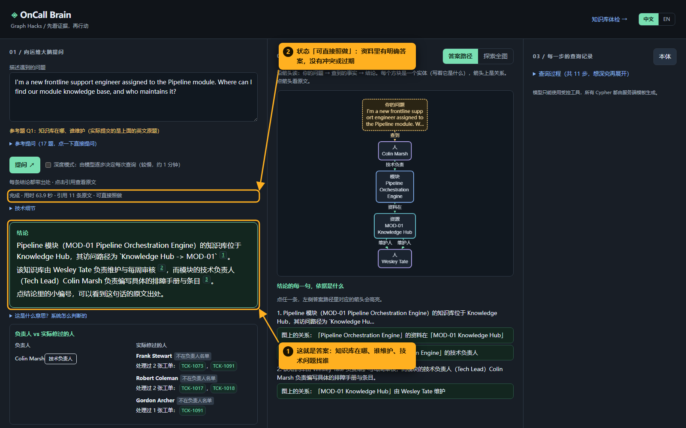
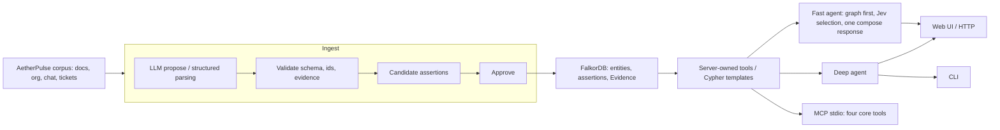

# OnCall Brain

> Ask who owns it, who has fixed it, which rule applies, and what to do next. Follow each answer back to its source line.

**FalkorDB Graph Hacks - Track: T3 Company Brain**

OnCall Brain joins operations documents, organisation records, chat discussions,
and support tickets in a FalkorDB knowledge graph. It separates official
responsibility from ticket-handling history, keeps rule replacement chains,
and answers with clickable evidence instead of unsupported assignments.

All company records describe **AetherPulse**, a fictional company. The corpus,
people, teams, territories, tickets, and policies are synthetic.



- **Demo video:** <VIDEO_URL>
- **Screenshot walkthrough (Chinese captions):** [docs/walkthrough/README.md](docs/walkthrough/README.md)

## Install / Quick start

Requires Python 3.12, Docker, and any OpenAI-compatible tool-calling model.
Run commands from the repository root. No extraction cache is included in the
public snapshot: the first ingest makes paid or quota-consuming LLM requests.

### 1. Start FalkorDB and install dependencies

```bash
docker run -d --name oncall-falkor -p 127.0.0.1:6379:6379 falkordb/falkordb
python -m venv .venv
```

Activate the environment with `source .venv/bin/activate` on Bash, or
`.\.venv\Scripts\Activate.ps1` on PowerShell, then install:

```bash
python -m pip install -r requirements.txt
# Optional: needed only when enabling Jev candidate selection below
python -m pip install requests
# Optional: to run the test suite
python -m pip install pytest
```

### 2. Configure .env

Create a UTF-8 file named `.env` in the repository root (gitignored). This
snapshot has no `.env.example`; use this complete example and replace the
endpoint, model, and key placeholders. Keep keys out of Git.

```dotenv
FALKOR_HOST=127.0.0.1
FALKOR_PORT=6379
GRAPH_NAME=oncall_brain
LLM_BASE_URL=https://<your-openai-compatible-endpoint>/v1
LLM_MODEL=<your-tool-calling-model>
LLM_API_KEY=<your-key>
# Optional: override fast-mode compose/translation model
# FAST_MODEL=<your-fast-model>
# Optional: use a separate evaluation judge
# LLM_JUDGE_MODEL=<your-judge-model>
# Optional: enable Jev selection (also install requests above)
# TYPESAFE_API_KEY=<your-typesafe-key>
```

The endpoint must support JSON-object responses for ingest (a reply wrapped in
a Markdown code fence is accepted); semantic-slot annotation requests `reasoning_effort="low"`.
Provider support for these options matters even when tool calling works.

### 3. Ingest, approve, and inspect

```bash
python cli.py ingest
python cli.py approve
python cli.py stats
python cli.py ask "Where can I find our module knowledge base for Pipeline?"
```

`ingest` rebuilds the configured graph. It parses structured records, asks the
LLM to propose assertions, validates them, and writes candidates; `approve`
changes **all** candidate relationships to approved and logs the operation in
`ingest/approved.log`. Review `ingest/rejected.jsonl` for rejected proposals.
`stats` prints graph size, predicate counts, and evidence-source distribution.

On a cold cache, extraction makes one LLM call per free-text corpus slice
(`corpus/docs/*.md` sections and `corpus/chats/*.md` windows), with up to three
attempts per slice. Semantic-slot annotation then makes an additional call per
batch of up to 12 referenced document/chat evidence records. These stages run
sequentially. In our clean-checkout test (fresh venv, empty cache, empty graph)
a full ingest took about **2 hours 10 minutes** wall-clock: 93 slices, 266
relationships accepted and 1 rejected, 185 evidence records slot-annotated,
628 assertions approved. That time includes provider timeouts; a run stopped by
a timeout resumes where it left off when re-run, because finished slices are
cached under `ingest/cache`.

For a quick look, `python cli.py ingest --no-llm` builds only the structured
sources (organisation roster, module registry, tickets) in under a minute, with
no model calls: 254 entities and 366 assertions (then run `approve`). It omits
free-text documents and chats, so it cannot answer the full question set.

### 4. Start the Web UI on the same graph

```bash
python -m web.app
```

The Web UI reads the same `.env`, so it opens the graph you just built.

Open **http://127.0.0.1:8000/**. Set `WEB_PORT` to change the port. Ask an English
question or choose one of the 17 gold-card examples. The answer path shows the
facts behind the conclusion and replaced rules; click a citation to inspect
its source, expand neighbours in Explore, and open the trace to inspect executed
queries. Streaming progress includes retrieval, selection, reads, and a compose
timer. The UI supports English and Chinese answers.

| Page | What to inspect |
|---|---|
| `/` | Question answering, owner/handler card, answer path, evidence, Explore, and step trace |
| `/health` | KB risk checks, module impact, and procedure ordering; choose the graph-backed view for live graph results |
| `/demo` | Isolated notice/supersession demonstration; configure a demo graph as described below |

HTTP routes in `web/app.py` (all GET unless marked POST):

| Routes | Purpose |
|---|---|
| `/api/examples`, `/api/ontology` | Gold questions and controlled ontology |
| `/api/search?q=Pipeline`, `/api/node/<node_id>`, `/api/neighbors/<node_id>` | Entity search, readback, and one-hop exploration |
| **POST** `/api/ask`, **POST** `/api/ask/stream` | Answer JSON or server-sent progress events; body includes `question`, optional `mode` and `lang` |
| `/api/health`, `/api/modules`, `/api/impact/<module_id>` | Health report, module choices, impact report |
| `/api/procedures`, `/api/procedure/<procedure_id>/steps` | Procedure choices and evidence-backed steps |
| **POST** `/api/demo/notice`, **POST** `/api/demo/reset` | Insert a notice into, or delete, the configured `_demo` graph |

### Fast mode and other entry points

Web defaults to `mode: "fast"`; send `mode: "deep"` to either ask endpoint for
the model-driven tool loop. There is no CLI `--fast` flag: `cli.py ask` and the
gold-card runner call `agent.ask` (deep mode). Python callers can explicitly use
`oncall_brain.fast.ask_fast(question)`.

Fast mode retrieves first: fulltext/identifier candidates and IDF-weighted
source lines -> Jev chooses entities to read -> read approved graph assertions
-> optionally select and read one more neighbour hop -> run module expertise for
who-to-ask questions -> one compose-model response. Jev uses `jev-latest` at
TypeSafe System One, enabled by `TYPESAFE_API_KEY`. Without a key, or on request
failure, selection falls back to fulltext ranking. It can make two Jev requests
(initial candidates and neighbours). Initial Jev selection reads at most five
entities; the next hop reads at most three. The fallback initially takes four.

The compose model is `FAST_MODEL` falling back to `LLM_MODEL` (or a Python
`model` argument). Normally there is one compose call, with one retry on an
empty response or provider error. A Chinese question adds a best-effort English
translation call before retrieval. Both modes share citation grounding and
answer-status checks; fast mode does not ask the model to generate Cypher.

```bash
python cli.py mcp  # stdio server for an MCP client; runs until disconnected
```

MCP exposes `describe_ontology`, `search_knowledge`, `read_knowledge`, and
`query_relations`. `module_expertise` is additionally available in the Python
agent tool registry and fast-mode pipeline; it is not registered in the MCP
adapter. Health, impact, and sequence are Python/HTTP features.

## Architecture



FalkorDB joins across source types, resolves ownership and ticket handlers,
filters relationship visibility at each hop, and retains replacement history.
The model composes an answer from retrieved evidence. It never executes arbitrary
model-written Cypher. CLI uses the deep agent, while MCP exposes retrieval tools
to its client rather than running the fast agent itself.

## Features

### Who has actually fixed it (`module_expertise`)

As an on-call engineer, I want to see the official owner alongside people who
have handled the module's tickets, so that I can find experienced help while
preserving the escalation path.

`tools.module_expertise` joins `Ticket -ABOUT-> Module` with
`Ticket -HANDLED_BY-> Person`, applying visibility to both edges, then compares
handlers with `TECH_LEAD_OF` / `MAINTAINED_BY` neighbours. Python deduplicates and
ranks handlers by ticket count. Fast mode triggers this for who-to-ask questions;
the Web card links to ticket evidence. Ticket history proves past handling,
not current availability, official ownership, or that an absent owner never
handled an issue.

### KB health check (`kb_health`, `/health`)

As an on-call engineer maintaining the knowledge base, I want risks grouped by
module and rule, so that I can locate ownership gaps and policy cleanup work.

`health.kb_health` queries `TECH_LEAD_OF` for people covering two or more modules,
joins module owners with ticket handlers, finds Rule/Notice relationships whose
evidence resolves only to chat sources, checks competing semantic slots and
single-valued predicates, and reads `SUPERSEDES` chains with dates. Modules
without handler history are omitted from owner/handler comparison. Totals count
stored entities, assertions of every state, and tickets; risk relationships use
current visibility. These are maintenance signals, not measured staffing limits.
Use the graph-backed view of `/health` or inspect `/api/health` directly.

### Impact analysis (`module_impact`)

As an on-call engineer, I want a module's owners, teams, resources, rules, and
historical ticket footprint together, so that I can identify whom to involve
and then verify the current incident's scope.

`impact.module_impact` follows `TECH_LEAD_OF` then `MEMBER_OF`, `HAS_RESOURCE`,
reverse `APPLIES_TO`, and reverse `ABOUT` plus `HANDLED_BY`. It resolves territory
nodes and follows reverse `COVERS_TERRITORY` to find contacts. Territory/tenant
fields are parsed from ticket evidence JSON, **not graph relationships**. They
show historical ticket scope, not a live outage or dependency propagation.
Choose a module on `/health`, or call `/api/impact/<module_id>`.

### Procedure sequence (`PRECEDES` topological order)

As an on-call engineer, I want sourced step order, explicit parallel steps, and
unknown order distinguished, so that I can follow a procedure without inventing
its sequence.

`sequence.procedure_steps` queries `HAS_STEP`, then `PRECEDES` and
`PARALLEL_WITH` between member steps, and retrieves rules, resources, performers,
and required fields. Python contracts explicit parallel components and applies
Kahn topological sorting with cycle detection. Sharing a topological frontier
does not prove explicit parallelism; steps without ordering evidence remain
order-unknown. Inspect the sequence section on `/health` or the procedure API.

### Freshness demo (`SUPERSEDES`, `/demo`)

As an on-call engineer, I want to add an effective-dated replacement in an
isolated graph and repeat the same question, so that I can show how knowledge
updates change the current answer while retaining its history.

`freshness.clone_demo_graph` uses `GRAPH.COPY`. `add_notice` checks the old
Rule/Notice, duplicate ids and existing notice authority, reads inherited
`APPLIES_TO` / `GOVERNED_BY` context along the replacement chain, then atomically
creates a Notice, Evidence, approved `SUPERSEDES` edge, and copied scope edges.
The demo's 30-minute timeout is an injected example replacing the corpus's
60-minute notice; it is not an original corpus policy. New source text is
preserved, but structured numeric claims are not extracted (`claims_json=[]`).

After normal ingest/approve, stop the normal Web process and use a separate
terminal for this PowerShell sequence (choose an unused demo port):

```powershell
python -c "from oncall_brain.freshness import clone_demo_graph; print(clone_demo_graph('oncall_brain','oncall_brain_freshness_demo'))"
$env:GRAPH_NAME='oncall_brain_freshness_demo'
$env:DEMO_GRAPH=$env:GRAPH_NAME
$env:ONCALL_NOW='2026-10-16'
$env:WEB_PORT='18002'
python -m web.app
```

1. Open `http://127.0.0.1:18002/demo` and read the prefilled rule id `Rule:Default_Step_Timeout_60_Minutes`.
2. Inspect the 60-minute rule and its source.
3. Add the prefilled 30-minute notice with effective date `2026-10-16`.
4. Read the same rule again; follow its replacement to the new notice and evidence.
5. Inspect the greyed old rule, new notice, and effective date (120 -> 60 -> 30 chain).
6. Reset to delete the entire demo graph; stop its Web process. Copy again for another demonstration.

The `/demo` page uses graph reads directly, without an LLM. To demonstrate
composed answers too, ask the same timeout question on that server's `/` before
and after insertion. `GRAPH_NAME` (reads) and `DEMO_GRAPH` (writes/reset) must
match. Only names ending in `_demo` can be written/deleted by these helpers;
copy refuses an existing destination. Future notices remain invisible until
their effective date. A fresh terminal restores normal settings after the demo.

### Answer states and conflict support

| State | User-facing meaning |
|---|---|
| `applicable` | The retrieved evidence supports an actionable answer |
| `superseded` | An old rule has a visible replacement; inspect the chain and date |
| `insufficient_context` | A required condition or supported detail is missing |
| `conflict` | Competing claims or cited source statements require reconciliation |
| `not_found` | The material retrieved does not support the requested answer |

Graph conflict checks require the same subject/slot, different mutually
exclusive values, compatible conditions, and overlapping validity intervals.
Multi-valued facts, different value kinds, or differently qualified measured
items (for example, different violation categories in a penalty scale) are not
automatically conflicts.

A model's `conflict` label survives the Web check only with a graph conflict
record **or at least two distinct source-line references in its Conflicts
section**. Otherwise the response reports `status_source: conflict_unsupported`
and falls back to `applicable` with evidence or `not_found` without it. This
source-line check counts distinct locators; it does not independently prove
that their meanings contradict. Unmatched citations can further downgrade the
response to `insufficient_context` (`citation_validation`).

## Graph model

Business nodes all carry `:Entity`; `Evidence` nodes deliberately do not, so they
never appear in business traversals.

| Label | Example | Notes |
|---|---|---|
| Person / Team / Vendor / Role | Colin Marsh, Operations Engineering Team (L2) | Role ≠ Person |
| Module | MOD-01 … MOD-29 | |
| Territory | Northland Metro … | 12 territories |
| Resource | Knowledge Hub - MOD-01, Sentinel Desk | `rtype`: kb / portal / channel / form / doc |
| Procedure | Escalate_to_Tier2, Weekly_Report_Submission | |
| WorkStage | Day1_Onboarding, Daily_Response | |
| Rule / Notice | Rule:Intake_Claim_SLA_15_Min | Rules may carry a `condition` |
| Ticket | TCK-1001 … | |

### Controlled predicates

Unregistered predicates are rejected at both ingest and query time. Domain and
range are validated per assertion.

| Predicate | Direction | Single-valued | Semantics / no-derivation rule |
|---|---|---|---|
| MEMBER_OF | Person → Team | no | membership; `primary` marks the main assignment |
| EMPLOYED_BY | Person → Vendor | yes | vendor affiliation |
| HOLDS_ROLE | Person → Role | no | time-boxed; expired on handover |
| TECH_LEAD_OF | Person → Module | no | module Tier 2 owner — **the escalation target** |
| HAS_RESOURCE | Module → Resource | no | knowledge base / portal / channel |
| MAINTAINED_BY | Resource → Person | no | proves document curation **only**; never an escalation target |
| COVERS_TERRITORY | Person → Territory | no | field coverage |
| HAS_STEP | Procedure → WorkStage | no | |
| PRECEDES / PARALLEL_WITH | WorkStage → WorkStage | no | ordering |
| PERFORMED_BY | Procedure → Role\|Team\|Person | no | who executes |
| RECEIVED_BY | Procedure → Role\|Team\|Person | no | who receives; needs direct evidence |
| USES_RESOURCE | Procedure\|WorkStage\|Module\|Role\|Rule → Resource | no | entry point / form |
| REQUIRES_FIELD | Procedure → Resource | no | mandatory form field |
| GOVERNED_BY | Procedure\|WorkStage\|Resource\|Rule → Rule\|Notice\|Resource | no | applicable rule |
| APPLIES_TO | Rule\|Notice → Module\|WorkStage\|Territory | no | scope |
| SUPERSEDES | Notice\|Rule → Rule | no | old rule leaves current answers |
| ABOUT / HANDLED_BY | Ticket → Module / Ticket → Person | no | ticket facts |

Responsibility predicates never imply each other: `MAINTAINED_BY` ≠ `TECH_LEAD_OF`
≠ `RECEIVED_BY` ≠ `MEMBER_OF`. A duty without direct evidence is reported as a gap.

Each assertion carries `aid`, `authority` (`formal_rule` > `practice` >
`observation`), `valid_from` / `valid_to`, `state`, and its evidence ids.

### Visibility

Every hop is filtered server-side:

```
r.state = 'approved'
AND r.valid_from <= $now
AND (r.valid_to IS NULL OR r.valid_to > $now)
```

An entity targeted by a visible `SUPERSEDES` edge is flagged superseded and held
out of current answers, but surfaced together with its replacement and effective
date.

## Cypher templates

All queries are server-owned: the model chooses arguments, predicates (only
registered ones are accepted), direction, and hop count, never Cypher text. The
full inventory of about 50 queries, each with its `file:function`, is in
[docs/queries.md](docs/queries.md).

### Three key queries, copied from the source query strings

These are the exact assembled Cypher strings, preserving source concatenation
and whitespace, with the shared visibility constant expanded. Parameters remain
parameters; no model-authored rewrite or illustrative predicates are substituted.

Ticket-to-module-to-handler join - `oncall_brain/tools.py:module_expertise`

```cypher
MATCH (k:Entity)-[a:ABOUT]->(m:Entity {id: $id}), (k)-[h:HANDLED_BY]->(p:Entity) WHERE a.state = 'approved' AND a.valid_from <= $now AND (a.valid_to IS NULL OR a.valid_to > $now) AND h.state = 'approved' AND h.valid_from <= $now AND (h.valid_to IS NULL OR h.valid_to > $now) RETURN k.id, k.kind, k.name, m.kind, m.name, p.id, p.kind, p.name, a.aid, a.authority, a.evidence, h.aid, h.authority, h.evidence
```

Current replacement edges - `oncall_brain/tools.py:TEMPLATES["superseded_targets"]`

```cypher
MATCH (n)-[r:SUPERSEDES]->(o) WHERE r.state = 'approved' AND r.valid_from <= $now AND (r.valid_to IS NULL OR r.valid_to > $now) RETURN o.id, n.id, r.aid, r.valid_from
```

Procedure order constraints - `oncall_brain/sequence.py:_ordering`

```cypher
MATCH (a:Entity)-[r]->(b:Entity) WHERE type(r) IN ['PRECEDES', 'PARALLEL_WITH'] AND r.state = 'approved' AND r.valid_from <= $now AND (r.valid_to IS NULL OR r.valid_to > $now) AND a.id IN $ids AND b.id IN $ids RETURN a.id, b.id, type(r), r.aid, r.evidence
```

## Tools and ingest contract

| Tool | Input | Output |
|---|---|---|
| `describe_ontology` | None | Kinds, predicate semantics, authority levels, behaviour rules, budgets |
| `search_knowledge` | `query`, optional `kind`, `limit` | Candidate ids and matching source evidence |
| `read_knowledge` | `id`, optional `context` | Entity, visible assertions, evidence, applicability, replacements |
| `query_relations` | `start_id`, `predicates`, optional direction/context, max 3 hops | Paths, evidence, conflicts, truncation |
| `module_expertise` | `module_id`, optional `limit` | Owners, ranked handlers, ticket paths, evidence |

Deep-mode budget: at most 8 tool calls and 6 relation queries per question.
Ids come from tool results. Retrieved source lines and nearby thread context
help preserve enumerations, exceptions, and penalties. Answers begin with a
short cited conclusion, followed by basis, common practice, conflicts/replacements,
and gaps; citations pair assertion ids with `file:line`.

Structured organisation/ticket sources and the module registry are parsed
without an LLM. Free-text documents and chats go through LLM proposal, registered
predicate/domain/range and evidence validation, entity alignment, and semantic
slot annotation. Accepted assertions start as candidates. Chat claims default
to observation; announced policy can be practice, never automatically formal_rule.
Every quoted evidence line must match the source or the assertion is rejected.
Caches avoid matching extraction requests; they do not eliminate first-run
provider calls or guarantee identical output after a rebuild with another model.

## Evaluation

After full ingest and approval, run:

```bash
python eval/run_gold.py
# Optional: reuse available answers and run judging again
python eval/run_gold.py --judge-only
```

The runner parses 17 gold cards from `docs/02-答案卡.md` (Chinese card text,
English questions), calls the **deep** agent on the configured live graph,
and grades expected state, required points, cited evidence, and forbidden errors.
This is not a fast-mode benchmark. Both answering and judging call the provider;
`LLM_JUDGE_MODEL` overrides the judge, otherwise it uses `LLM_MODEL`.
`--judge-only` still generates answers for cards missing from its answer cache.

Outputs: `eval/results/latest.md`, timestamped Markdown and JSON reports,
`answers_cache.json`, and a judge cache. Reports include tool arguments, executed
template names, answers, citations, PASS/FAIL, and provenance (commit, graph/model,
and fingerprints). Existing `eval/snapshot/` files are historical runs, not the
frozen-build result. LLM judging can vary; rerun commands to obtain measurements
for your configured graph and models.

Final eval (frozen build): <TBD by lead>

## FalkorDB notes

Two behaviours of the FalkorDB build this was developed against shaped the code:

- Creating an edge *from* a bound relationship variable fails
  (`The alias 'r' was specified for both a node and a relationship`), regardless
  of alias name, `MERGE` vs `CREATE`, or re-matching the relationship. Evidence is
  therefore stored as the relationship's `evidence` property rather than as
  `(rel)-[:EVIDENCE]->(e)`.
- A `MATCH`-based `MERGE` writes nothing when an endpoint does not exist, failing
  silently. Each edge now merges its own endpoints first, so payload ordering
  cannot drop assertions.

## Disclosure - Rule 11

All company data is fictional AetherPulse material. AI assistance used during
development is disclosed separately from runtime inference:

| Development assistant / model | Contribution |
|---|---|
| Claude Code - Anthropic Claude | Lead implementation, review, and fixes |
| OpenAI Codex - GPT | Features and documentation |
| Google Antigravity CLI - Gemini | Frontend pages |
| Hunyuan `hy4-preview`, driven through Claude Code | Backend KB health and conflict fix |

Runtime accepts **any OpenAI-compatible tool-calling model** meeting the ingest
JSON/options requirements above; development used `gemini-3.8-flash-high`
(recorded in the committed evaluation snapshots and as the ingest fallback).
`LLM_MODEL`, `LLM_BASE_URL`, and `LLM_API_KEY` configure the main endpoint;
`FAST_MODEL` optionally overrides fast compose/translation, and
`LLM_JUDGE_MODEL` optionally overrides judging. The deep agent requires an
explicit `LLM_MODEL`; the ingest fallback is not a universal runtime default.
Optional selection uses TypeSafe Jev `jev-latest` via `TYPESAFE_API_KEY` and
falls back to search ranking when unavailable.

Every metric comes from running the commands above rather than from an
assistant's claims.
