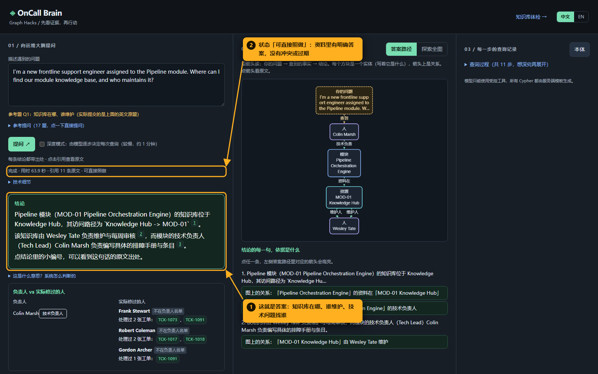
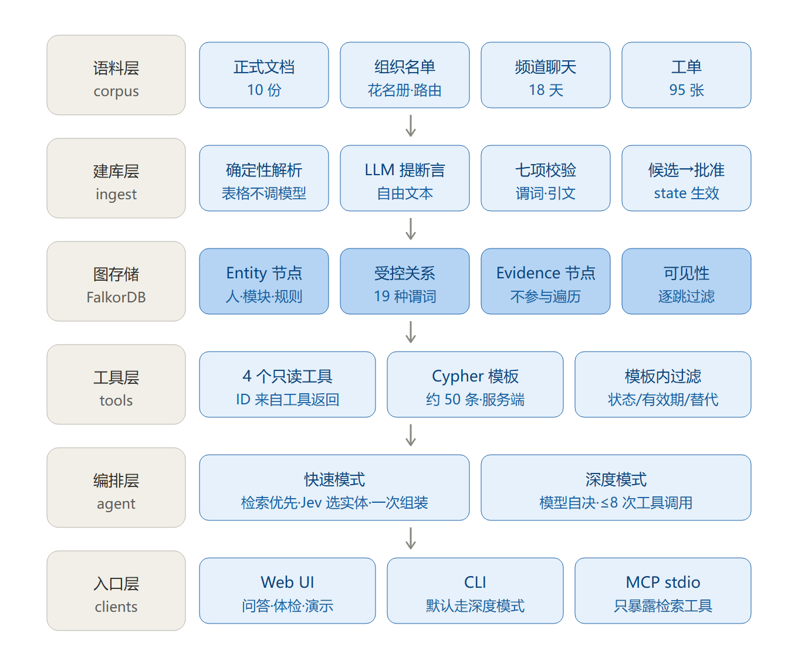
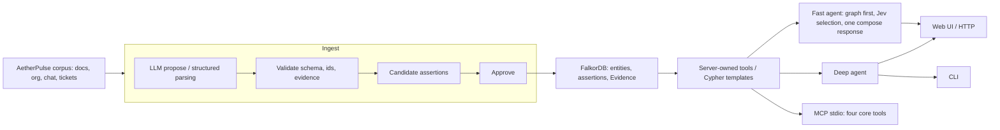
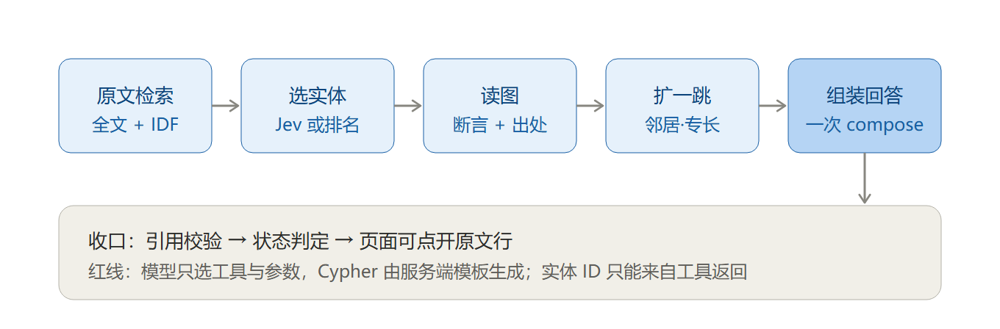

# OnCall Brain

[English](README.md) · 简体中文

> 谁负责，谁修过，按哪条规则办，下一步做什么。每个答案都能追回它出自哪一行原文。

> 本文是 [README.md](README.md) 的中文对照，命令、代码、Cypher 与关系名保持英文原样。两版内容逐节对应，如有出入以英文版为准。

OnCall Brain 把运维文档、组织名单、频道聊天和支持工单接进一张 FalkorDB 知识图谱。正式职责与工单处理记录分开存，规则之间的替代关系会保留下来，回答时给出能点开的出处，不做没有依据的指派。

语料里所有公司资料都围绕虚构的 **AetherPulse**。文档、人员、团队、区域、工单和制度都是合成的。



- **演示视频（3 分钟）** https://youtu.be/gifjF3u3s0c
- **截图讲解（中文注释）** [docs/walkthrough/README.md](docs/walkthrough/README.md)
- **需求规格与用户故事（中文）** [docs/03-需求规格说明.md](docs/03-需求规格说明.md)

## 安装与快速开始

需要 Python 3.12、Docker，以及任意一个兼容 OpenAI 接口、支持工具调用的模型。命令都在仓库根目录执行。公开快照不带抽取缓存，第一次建库会产生计费或消耗额度的模型请求。

### 1. 启动 FalkorDB 并安装依赖

```bash
docker run -d --name oncall-falkor -p 127.0.0.1:6379:6379 falkordb/falkordb
python -m venv .venv
```

Bash 下用 `source .venv/bin/activate` 激活环境，PowerShell 下用 `.\.venv\Scripts\Activate.ps1`，然后安装依赖。

```bash
python -m pip install -r requirements.txt
# Optional: needed only when enabling Jev candidate selection below
python -m pip install requests
# Optional: to run the test suite
python -m pip install pytest
```

### 2. 配置 .env

在仓库根目录建一个 UTF-8 编码的 `.env` 文件，它已被 git 忽略。快照里没有 `.env.example`，照下面这份完整示例填，把端点、模型和密钥占位符换成自己的值。密钥不要进 Git。

```dotenv
FALKOR_HOST=127.0.0.1
FALKOR_PORT=6379
GRAPH_NAME=oncall_brain
LLM_BASE_URL=https://<your-openai-compatible-endpoint>/v1
LLM_MODEL=<your-tool-calling-model>
LLM_API_KEY=<your-key>
# Optional: override fast-mode compose/translation model
# FAST_MODEL=<your-fast-model>
# Optional: use a separate evaluation judge
# LLM_JUDGE_MODEL=<your-judge-model>
# Optional: enable Jev selection (also install requests above)
# TYPESAFE_API_KEY=<your-typesafe-key>
```

建库要求端点返回 JSON 对象，包在 Markdown 代码围栏里的回复也能接受。语义槽标注会请求 `reasoning_effort="low"`。工具调用能跑通还不够，这些选项得单独确认供应商支持。

### 3. 建库、批准与查看

```bash
python cli.py ingest
python cli.py approve
python cli.py stats
python cli.py ask "Where can I find our module knowledge base for Pipeline?"
```

`ingest` 会重建配置好的那张图，先解析结构化记录，让模型提出断言，校验通过再写成候选。`approve` 把**全部**候选关系改为已批准，并在 `ingest/approved.log` 记下这次操作。被拒的提议看 `ingest/rejected.jsonl`。`stats` 打印图的规模、各谓词的条数，以及证据来源的分布。

冷缓存下，抽取阶段对每个自由文本分片调一次模型，分片指 `corpus/docs/*.md` 的小节和 `corpus/chats/*.md` 的窗口，每片最多尝试三次。语义槽标注再按每批最多 12 条被引用的文档或聊天证据补一次调用。两个阶段顺序执行。在全新检出的环境里测过一次，虚拟环境、缓存和图都是空的，完整建库实际耗时约 **2 小时 10 分钟**，处理了 93 个分片，接受 266 条关系、拒绝 1 条，给 185 条证据记录做了语义槽标注，批准 628 条断言。这个时间包含供应商超时。因超时中断后重跑会接着上次继续，已完成的分片缓存在 `ingest/cache`。

只想快速看一眼，可以跑 `python cli.py ingest --no-llm`。它只建结构化来源，包括组织名单、模块登记表和工单，一分钟内完成，不调模型，得到 254 个实体和 366 条断言，随后还要跑 `approve`。自由文本文档和聊天都没有入库，完整的题目集答不上来。

### 4. 在同一张图上启动 Web 界面

```bash
python -m web.app
```

Web 界面读同一个 `.env`，打开的正是刚建好的那张图。

打开 **http://127.0.0.1:8000/** ，端口由 `WEB_PORT` 调整。可以英文提问，也可以点 17 道金标准题之一。答案路径会列出结论背后的事实和被替代的规则，点引用能看原文，在 Explore 里展开邻居，打开查询过程能看到实际执行过的查询。流式进度覆盖检索、挑选、读图和组装计时。界面支持中英文回答。

| 页面 | 看什么 |
|---|---|
| `/` | 问答、负责人与处理人卡片、答案路径、证据、Explore、分步查询过程 |
| `/health` | 知识库风险检查、模块影响、流程顺序；要看实时图结果，切到接图的视图 |
| `/demo` | 隔离出来的通知与替代演示；按下文配置演示图 |

`web/app.py` 里的 HTTP 路由如下，除标明的 POST 外都是 GET。

| 路由 | 用途 |
|---|---|
| `/api/examples`、`/api/ontology` | 金标准题目与受控本体 |
| `/api/search?q=Pipeline`、`/api/node/<node_id>`、`/api/neighbors/<node_id>` | 实体搜索、读回、一跳邻居探索 |
| **POST** `/api/ask`、**POST** `/api/ask/stream` | 回答 JSON 或服务端推送的进度事件，请求体带 `question`，可选 `mode` 和 `lang` |
| `/api/health`、`/api/modules`、`/api/impact/<module_id>` | 体检报告、模块选项、影响报告 |
| `/api/procedures`、`/api/procedure/<procedure_id>/steps` | 流程选项与带证据的步骤 |
| **POST** `/api/demo/notice`、**POST** `/api/demo/reset` | 在配置好的 `_demo` 图里插入通知，或删除这张图 |

### 快速模式与其他入口

Web 默认走 `mode: "fast"`。两个提问接口传 `mode: "deep"` 就切到由模型驱动的工具循环。CLI 没有 `--fast` 参数，`cli.py ask` 和金标准题脚本都调 `agent.ask`，也就是深度模式。Python 调用方可以直接用 `oncall_brain.fast.ask_fast(question)`。

快速模式先检索，拿全文与标识符候选、按 IDF 加权的原文行，再由 Jev 挑要读的实体，读已批准的图断言，可选地再挑一跳邻居读回来，遇到找人问题补一次模块专长查询，最后由组装模型出一次回答。Jev 用 TypeSafe System One 的 `jev-latest`，由 `TYPESAFE_API_KEY` 启用。没配密钥或请求失败时，挑选回退到全文排序。整条链路最多发两次 Jev 请求，一次选初始候选，一次选邻居。初次挑选最多读 5 个实体，下一跳最多 3 个，回退路径初次取 4 个。

组装回答用 `FAST_MODEL`，没配就回退到 `LLM_MODEL`，Python 调用时也可以直接传 `model` 参数。通常只调一次组装，遇到空回复或供应商报错重试一次。中文问题会在检索前尽力加一次英译。两种模式共用引用校验和答案状态判定，快速模式不让模型写 Cypher。

```bash
python cli.py mcp  # stdio server for an MCP client; runs until disconnected
```

MCP 暴露 `describe_ontology`、`search_knowledge`、`read_knowledge` 和 `query_relations` 四个工具。`module_expertise` 在 Python agent 的工具表和快速模式链路里也有，MCP 适配器没有注册它。体检、影响分析和流程顺序走 Python 与 HTTP。

## 架构







可编辑的 SVG 源文件见[六层图](docs/architecture/architecture-layers.svg)和[查询链路](docs/architecture/architecture-query-flow.svg)。

FalkorDB 把不同来源的资料连起来，分清正式负责人和历史工单处理人，在每一跳上过滤关系的可见性，并保留规则替代的沿革。模型只根据检索到的证据组装回答，服务端从不执行模型随手写出的 Cypher。CLI 走深度模式，MCP 则把检索工具交给调用方，自己不跑快速模式。

## 功能

### 谁真正修过（`module_expertise`）

值班时想同时看到正式负责人和处理过这个模块工单的人，既能找到有经验的帮手，又不丢掉正式升级路径。

`tools.module_expertise` 把 `Ticket -ABOUT-> Module` 和 `Ticket -HANDLED_BY-> Person` 联起来查，两条边都过可见性过滤，再拿处理人和 `TECH_LEAD_OF`、`MAINTAINED_BY` 邻居对照。Python 按工单数去重排序。快速模式遇到找人问题会触发它，Web 卡片能点开工单证据。工单历史只证明过去处理过，当前是否有空、是否为正式负责人、没出现在名单里的人是否从未处理过，都不在这份记录的证明范围内。

### 知识库体检（`kb_health`，`/health`）

维护知识库时，想按模块和规则把风险归堆，好定位职责缺口和该清理的制度。

`health.kb_health` 查 `TECH_LEAD_OF`，找出一人带两个以上模块的情况；把模块负责人与工单处理人对照；找出证据只能追到聊天的 Rule/Notice 关系；检查互相竞争的语义槽和单值谓词；读带日期的 `SUPERSEDES` 链。没有处理记录的模块不进负责人对照。总量统计的是已存实体、各状态的断言和工单，风险关系按当前可见性算。这些是维护信号，测不出人员编制上限。看 `/health` 里接图的视图，或者直接查 `/api/health`。

### 影响分析（`module_impact`）

值班时想把某个模块的负责人、团队、资源、规则和历史工单范围放在一起看，先确定该找谁，再核实这次事件的实际影响面。

`impact.module_impact` 先沿 `TECH_LEAD_OF`，再走 `MEMBER_OF`、`HAS_RESOURCE`、反向 `APPLIES_TO`、反向 `ABOUT` 和 `HANDLED_BY`。它会把区域节点对齐，沿反向 `COVERS_TERRITORY` 找可通知的人。区域与租户字段从工单证据的 JSON 里解析，**图里没有对应关系**。这些字段说明历史工单波及的范围，当前故障和依赖扩散都不在其中。在 `/health` 选模块，或者调 `/api/impact/<module_id>`。

### 流程顺序（`PRECEDES` 拓扑排序）

值班时希望步骤的先后有出处，哪几步明确并行、哪几步顺序未知都能分清楚，照着流程走不用自己猜。

`sequence.procedure_steps` 查 `HAS_STEP`，再查成员步骤之间的 `PRECEDES` 和 `PARALLEL_WITH`，同时取回规则、资源、执行者和必填字段。Python 把明确并行的分量收缩起来，用 Kahn 拓扑排序并检测环。落在同一拓扑层并不足以证明两步明确并行，没有排序证据的步骤保持顺序未知。在 `/health` 的流程顺序区查看，或者走流程接口。

### 知识保持最新演示（`SUPERSEDES`，`/demo`）

想在一张隔离的图里加一条带生效日期的替代通知，再问同一个问题，看知识更新怎样改变当前答案，同时把旧答案的来龙去脉留着。

`freshness.clone_demo_graph` 用 `GRAPH.COPY` 复制图。`add_notice` 会检查旧的 Rule/Notice、重复的 id 和已有通知的权威级别，沿替代链读出继承的 `APPLIES_TO`、`GOVERNED_BY` 上下文，然后在一个事务里建出 Notice、Evidence、已批准的 `SUPERSEDES` 边和复制过来的适用范围边。演示里的 30 分钟超时是注入的例子，用来替换语料中的 60 分钟通知，语料原本没有这条政策。新通知的正文会保留，结构化的数值声明不抽取，`claims_json=[]`。

按常规建库并批准之后，停掉原来的 Web 进程，另开一个终端执行下面这段 PowerShell，演示端口挑一个没被占用的。

```powershell
python -c "from oncall_brain.freshness import clone_demo_graph; print(clone_demo_graph('oncall_brain','oncall_brain_freshness_demo'))"
$env:GRAPH_NAME='oncall_brain_freshness_demo'
$env:DEMO_GRAPH=$env:GRAPH_NAME
$env:ONCALL_NOW='2026-10-16'
$env:WEB_PORT='18002'
python -m web.app
```

1. 打开 `http://127.0.0.1:18002/demo`，记下预填的规则 id `Rule:Default_Step_Timeout_60_Minutes`。
2. 查看 60 分钟规则和它的出处。
3. 加入预填的 30 分钟通知，生效日期 `2026-10-16`。
4. 再读这条规则，顺着替代关系到新通知和它的证据。
5. 看置灰的旧规则、新通知和生效日期，链条是 120 → 60 → 30。
6. 点还原删掉整张演示图，停掉它的 Web 进程。要再演示一次得重新复制。

`/demo` 页面直接读图，不调模型。想连组装回答一起演示，就在插入前后分别到这台服务的 `/` 问同一个超时问题。`GRAPH_NAME` 管读，`DEMO_GRAPH` 管写和还原，两者要一致。这些辅助函数只允许写入或删除名字以 `_demo` 结尾的图，目标图已存在时复制会拒绝执行。未来才生效的通知，到生效日之前一直不可见。演示结束另开一个新终端，设置就回到常规状态。

### 答案状态与冲突判定

| 状态 | 面向用户的含义 |
|---|---|
| `applicable` | 查到的证据足以给出一个能照做的答案 |
| `superseded` | 旧规则已有生效中的替代，去看替代链和日期 |
| `insufficient_context` | 缺一个必要条件，或者缺有支撑的细节 |
| `conflict` | 互相竞争的说法或被引用的原文陈述，需要核对 |
| `not_found` | 查到的材料支撑不了所问的答案 |

图上的冲突判定要同时满足四个条件，主体和语义槽相同、取值不同且互斥、条件能同时成立、有效期有交集。多值事实、取值类型不同的事实、限定对象不同的计量项都不会自动判成冲突，扣分表里针对不同违规项设的档就是一例。

模型给出的 `conflict` 标签要过 Web 这关，得有图上的冲突记录，**或者 Conflicts 段里至少两处不同的原文行引用**。否则响应会把 `status_source` 记为 `conflict_unsupported`，有证据时回落到 `applicable`，没证据时回落到 `not_found`。这步只数不同的定位符，并不独立证明两处文字真的矛盾。引用对不上还会再降一级到 `insufficient_context`，状态来源是 `citation_validation`。

## 图模型

业务节点都带 `:Entity` 标签，`Evidence` 节点故意不带，这样业务遍历永远不会走到它们。

| 标签 | 示例 | 说明 |
|---|---|---|
| Person / Team / Vendor / Role | Colin Marsh, Operations Engineering Team (L2) | Role 与 Person 不是同一类 |
| Module | MOD-01 … MOD-29 | |
| Territory | Northland Metro … | 12 个区域 |
| Resource | Knowledge Hub - MOD-01, Sentinel Desk | `rtype` 取 kb / portal / channel / form / doc |
| Procedure | Escalate_to_Tier2, Weekly_Report_Submission | |
| WorkStage | Day1_Onboarding, Daily_Response | |
| Rule / Notice | `Rule:Intake_Claim_SLA_15_Min` | 规则可带 `condition` |
| Ticket | TCK-1001 … | |

### 受控谓词

未注册的谓词在建库和查询两个环节都会被拒。每条断言都校验定义域和值域。

| 谓词 | 方向 | 单值 | 语义与不可推导规则 |
|---|---|---|---|
| MEMBER_OF | Person → Team | 否 | 成员关系，`primary` 标记主要归属 |
| EMPLOYED_BY | Person → Vendor | 是 | 所属供应商 |
| HOLDS_ROLE | Person → Role | 否 | 有任期，交接时过期 |
| TECH_LEAD_OF | Person → Module | 否 | 模块二线负责人，**升级要找的人** |
| HAS_RESOURCE | Module → Resource | 否 | 知识库、门户、频道 |
| MAINTAINED_BY | Resource → Person | 否 | 只证明谁在维护文档，**永远不作升级对象** |
| COVERS_TERRITORY | Person → Territory | 否 | 负责的区域 |
| HAS_STEP | Procedure → WorkStage | 否 | |
| PRECEDES / PARALLEL_WITH | WorkStage → WorkStage | 否 | 先后顺序 |
| PERFORMED_BY | Procedure → Role\|Team\|Person | 否 | 谁执行 |
| RECEIVED_BY | Procedure → Role\|Team\|Person | 否 | 谁接收，需要直接证据 |
| USES_RESOURCE | Procedure\|WorkStage\|Module\|Role\|Rule → Resource | 否 | 入口或表单 |
| REQUIRES_FIELD | Procedure → Resource | 否 | 表单必填项 |
| GOVERNED_BY | Procedure\|WorkStage\|Resource\|Rule → Rule\|Notice\|Resource | 否 | 适用的规则 |
| APPLIES_TO | Rule\|Notice → Module\|WorkStage\|Territory | 否 | 适用范围 |
| SUPERSEDES | Notice\|Rule → Rule | 否 | 旧规则退出当前答案 |
| ABOUT / HANDLED_BY | Ticket → Module / Ticket → Person | 否 | 工单事实 |

职责类谓词互不推导，`MAINTAINED_BY`、`TECH_LEAD_OF`、`RECEIVED_BY`、`MEMBER_OF` 各有各的含义。一项职责没有直接证据时，会记为缺口。

每条断言都带 `aid`、`authority`（`formal_rule` > `practice` > `observation`）、`valid_from` / `valid_to`、`state`，以及它的证据 id。

### 可见性

每一跳都在服务端按下面这个条件过滤。

```
r.state = 'approved'
AND r.valid_from <= $now
AND (r.valid_to IS NULL OR r.valid_to > $now)
```

被一条生效中的 `SUPERSEDES` 边指向的实体会标成已替代，不进当前答案，但会连同替代它的新规则和生效日期一起列出来给人看。

## Cypher 模板

查询全归服务端所有，模型只挑参数、谓词（只接受已注册的）、方向和跳数，碰不到 Cypher 文本。约 50 条查询的完整清单连同各自的 `file:function` 记在 [docs/queries.md](docs/queries.md)。

### 三条关键查询，逐字取自源码查询串

下面是拼装后的 Cypher 原文，源码里的拼接方式和空白都保留，共用的可见性常量已展开。参数仍是参数，没有模型改写过的版本，也没有换成示意谓词。

工单到模块再到处理人的联查，`oncall_brain/tools.py:module_expertise`

```cypher
MATCH (k:Entity)-[a:ABOUT]->(m:Entity {id: $id}), (k)-[h:HANDLED_BY]->(p:Entity) WHERE a.state = 'approved' AND a.valid_from <= $now AND (a.valid_to IS NULL OR a.valid_to > $now) AND h.state = 'approved' AND h.valid_from <= $now AND (h.valid_to IS NULL OR h.valid_to > $now) RETURN k.id, k.kind, k.name, m.kind, m.name, p.id, p.kind, p.name, a.aid, a.authority, a.evidence, h.aid, h.authority, h.evidence
```

当前生效的替代边，`oncall_brain/tools.py:TEMPLATES["superseded_targets"]`

```cypher
MATCH (n)-[r:SUPERSEDES]->(o) WHERE r.state = 'approved' AND r.valid_from <= $now AND (r.valid_to IS NULL OR r.valid_to > $now) RETURN o.id, n.id, r.aid, r.valid_from
```

流程顺序约束，`oncall_brain/sequence.py:_ordering`

```cypher
MATCH (a:Entity)-[r]->(b:Entity) WHERE type(r) IN ['PRECEDES', 'PARALLEL_WITH'] AND r.state = 'approved' AND r.valid_from <= $now AND (r.valid_to IS NULL OR r.valid_to > $now) AND a.id IN $ids AND b.id IN $ids RETURN a.id, b.id, type(r), r.aid, r.evidence
```

## 工具与建库约定

| 工具 | 输入 | 输出 |
|---|---|---|
| `describe_ontology` | 无 | 种类、谓词语义、权威级别、行为规则、预算 |
| `search_knowledge` | `query`，可选 `kind`、`limit` | 候选 id 与命中的原文证据 |
| `read_knowledge` | `id`，可选 `context` | 实体、可见断言、证据、适用情况、替代记录 |
| `query_relations` | `start_id`、`predicates`，可选方向与 context，最多 3 跳 | 路径、证据、冲突、截断情况 |
| `module_expertise` | `module_id`，可选 `limit` | 负责人、排序后的处理人、工单路径、证据 |

深度模式每道题最多 8 次工具调用、6 次关系查询。id 只能取自工具返回的结果。检索到的原文行和相邻对话上下文，能保住枚举项、例外和罚则这类细节。回答先给一段带出处的简短结论，再依次写依据、常见做法、冲突与替代、缺口，引用把断言 id 和 `file:line` 配对。

结构化的组织与工单资料、模块登记表不经过模型，直接解析。自由文本文档和聊天要走模型提议、已注册谓词与定义域值域及证据校验、实体对齐、语义槽标注，通过的断言先记为候选。聊天里的说法默认是 observation，公告过的政策可以算 practice，不会自动升成 formal_rule。引用的每一行证据都要和原文对得上，对不上就拒绝该断言。缓存能省掉重复的抽取请求，首跑该调的模型还是要调，换一个模型重建后也不保证输出逐字一致。

## 评测

```bash
python eval/run_gold.py
# Optional: reuse available answers and run judging again
python eval/run_gold.py --judge-only
```

脚本从 `docs/02-答案卡.md` 解析 17 张金标准答案卡（卡片正文中文，题目英文），在配置好的实时图上调**深度**模式 agent，按期望状态、必答要点、引用证据和禁止出现的错误打分。这套题测的不是快速模式。回答和评判都会调模型，`LLM_JUDGE_MODEL` 可以单独指定评判模型，没配就用 `LLM_MODEL`。`--judge-only` 对答案缓存里缺的卡片仍会生成回答。

产物有 `eval/results/latest.md`、带时间戳的 Markdown 与 JSON 报告、`answers_cache.json` 和评判缓存。报告里记录工具参数、实际执行的模板名、回答、引用、PASS/FAIL，以及来源信息（提交、图与模型、指纹）。`eval/snapshot/` 里其他文件是历史运行，冻结版结果不在这里。模型评判会有波动，想拿到自己这套图和模型的数据，重跑命令即可。

冻结版最终评测（提交 `1fd1876`，图 `oncall_brain`，模型 `gemini-3.8-flash-high`，2026-10-17 跑过一次）**PASS 15 / 17**，0 次无效评判。两道没过的题记在 `eval/snapshot/final-frozen.md`。

- Q1，要点覆盖 1/3。答案给出了 Knowledge Hub 的路径和维护人，三个必答要点里评判只认了一个。
- Q7，四个要点都答到了，但答案把自己标成 `insufficient_context`，而答案卡期望的是 `applicable`。

## FalkorDB 相关说明

开发时用的那版 FalkorDB 有两个行为影响了代码写法。

- 从已绑定的关系变量出发建边会失败，报 `The alias 'r' was specified for both a node and a relationship`。换别名、改用 `CREATE` 或 `MERGE`、重新 `MATCH`，结果都一样。证据因此存在关系的 `evidence` 属性里，图上没有 `(rel)-[:EVIDENCE]->(e)` 这种边。
- 基于 `MATCH` 的 `MERGE` 在端点不存在时静默失败，什么也不写。现在每条边先合并自己的端点，载荷顺序再也不会弄丢断言。

## 披露 · 规则 11

全部公司资料都是虚构的 AetherPulse 素材。开发阶段的 AI 辅助与运行时的模型推理分开披露。

| 开发辅助工具 / 模型 | 承担的工作 |
|---|---|
| Claude Code · Anthropic Claude | 主要实现、评审与修复 |
| OpenAI Codex · GPT | 功能与文档 |
| Google Antigravity CLI · Gemini | 前端页面 |
| 混元 `hy4-preview`（经 Claude Code 驱动） | 后端知识库体检与一处冲突修复 |

运行时接受**任何满足上面建库 JSON 与选项要求的 OpenAI 兼容工具调用模型**，开发时用的是 `gemini-3.8-flash-high`（记在已提交的评测快照里，也用作建库回退模型）。`LLM_MODEL`、`LLM_BASE_URL` 和 `LLM_API_KEY` 配置主端点，`FAST_MODEL` 可单独指定快速模式的组装与翻译模型，`LLM_JUDGE_MODEL` 可单独指定评判模型。深度模式必须显式给 `LLM_MODEL`，建库回退值不是通用的运行时默认。可选的实体挑选通过 `TYPESAFE_API_KEY` 调 TypeSafe Jev `jev-latest`，不可用时回退到检索排序。

文中每个数字都由上面这些命令跑出来，没有引用助手自报的成绩。
