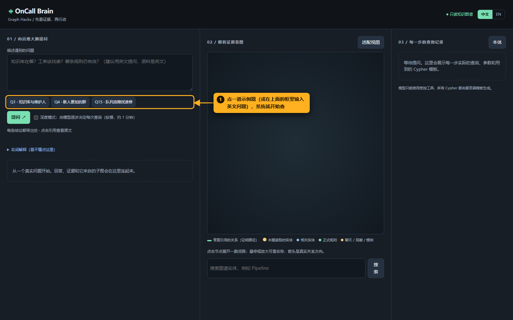
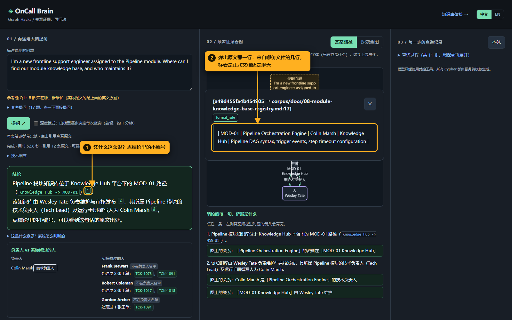
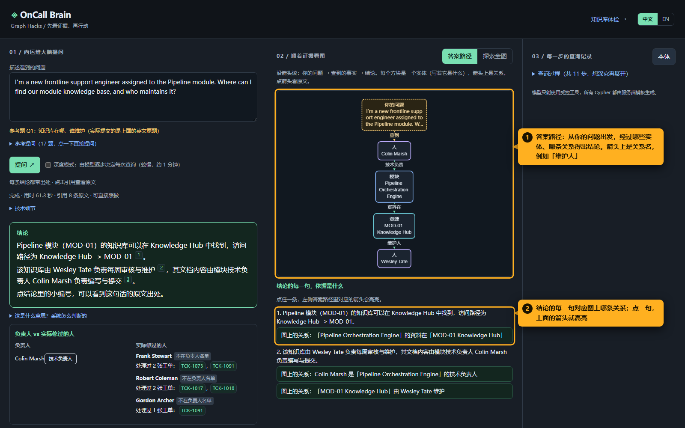
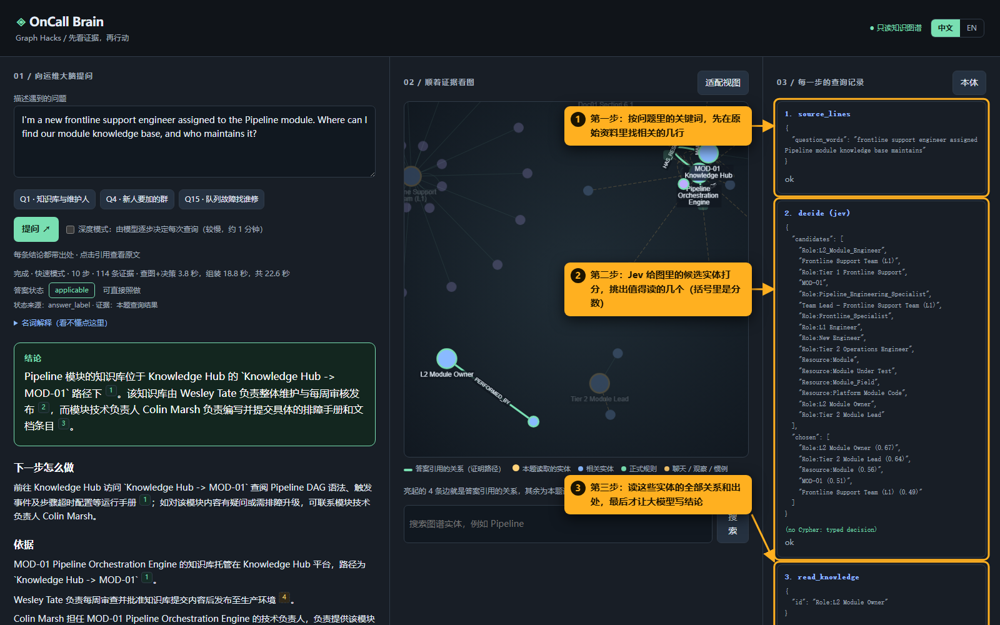
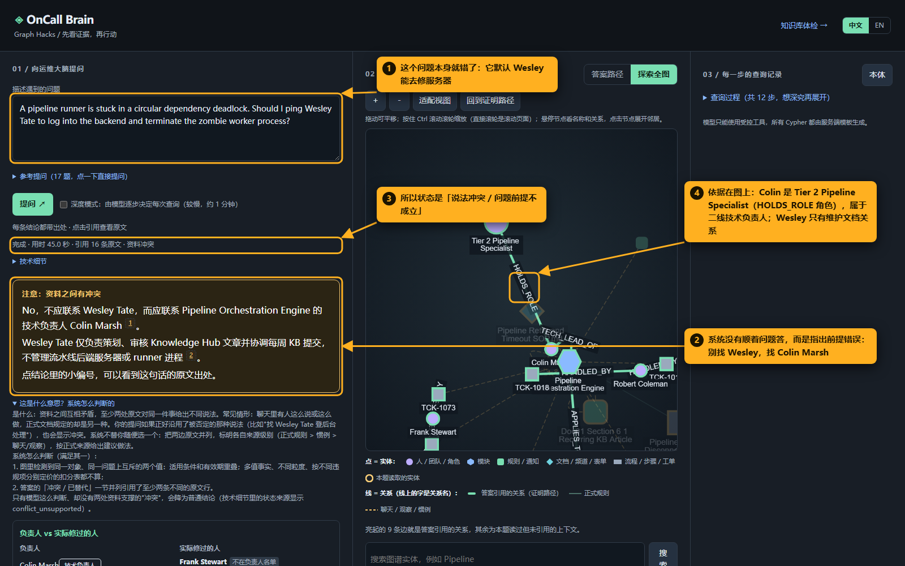
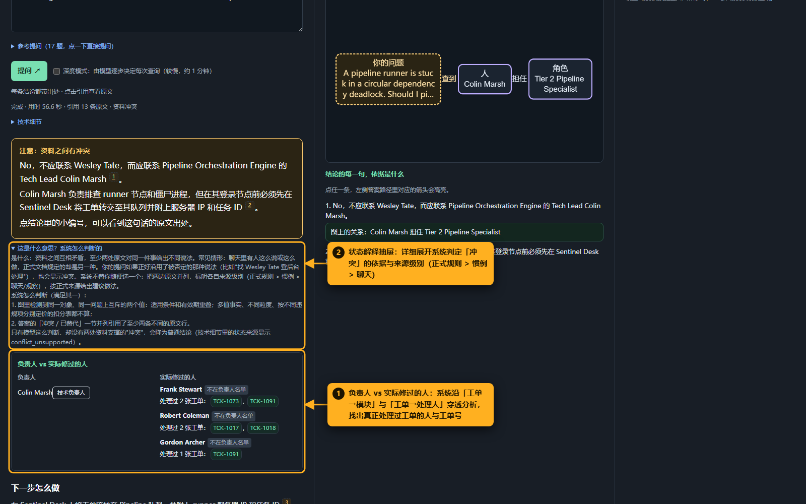
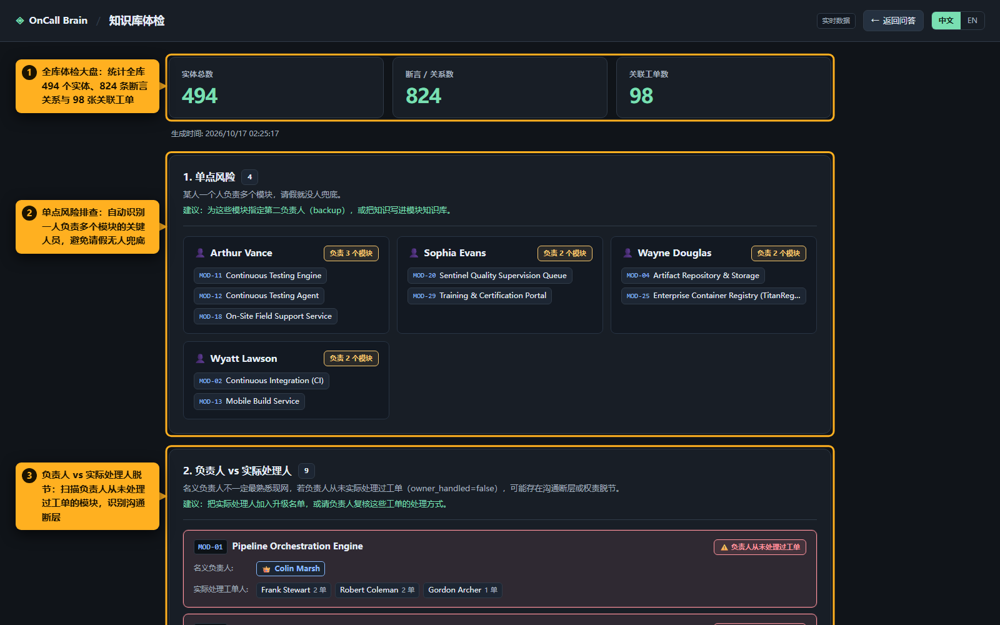

# OnCall Brain 使用说明

> 截图是脚本驱动真实网页、跑真实问题时自动截的（`scripts/walkthrough_shots.py`），橙色框和箭头是标注。
> 数据是虚构公司 AetherPulse 的合成资料。启动：`python -m web.app`，浏览器打开 http://127.0.0.1:8000 。

## 它解决什么问题

一家公司的规矩散在几十份文档、几百条聊天和工单里。新人值班时遇到问题，最想知道三件事：**该怎么做、找谁、这条规矩现在还算不算数**。

OnCall Brain 把这些资料整理成一张「知识图谱」：谁负责哪个模块、哪份文档由谁维护、哪条规则被哪条新通知替代，都记成图上的点和线，每条线都记着它来自哪份资料的第几行。

你问一句话，它**先查图，再让大模型把查到的内容写成结论**。结论里每一句都能点开看原文。图里查不到的，它直接说没有，不编。

---

## 一、用一个例子走一遍

例子：新人问「我负责 Pipeline 模块，模块知识库在哪？谁维护？」

### 1. 提问



点一道示例题，或者在输入框里写问题（资料是英文的，用英文问最准）。等大约 30 秒。

### 2. 看结论


1. **绿色框里就是答案**：知识库在 Knowledge Hub 的 MOD-01 下面；由 Wesley Tate 每周审核发布；模块内容由技术负责人 Colin Marsh 负责。
2. **答案状态**告诉你这个答案能不能直接用。这里是「可直接照做」，意思是资料里有明确答案，没有冲突，也没有过期。

结论下面的「下一步怎么做」「依据」是更详细的展开，不看也能用。

### 3. 凭什么这么说：点开出处



1. 结论里每句话后面都有小编号，点它。
2. 弹出原文那一行：来自哪份文件、第几行，是正式文档（formal_rule）还是聊天记录。

**这一步的意义**：答案的每一句都能追到原始资料，不是大模型凭印象说的。

### 4. 答案路径：结论是沿着哪几条关系得出的



1. 「答案路径」从你的问题出发，画出结论经过的实体和关系，箭头上是关系名，例如「技术负责」「资料在」「维护人」。点箭头可以看原文。
2. 下面逐句列出结论，每一句对应图上哪条关系；点一句，上面对应的箭头会高亮。切到「探索全图」，亮绿色的线就是同样这几条关系，变暗的是查过但没用上的内容。

本题的依据，连起来就是这两条路径：

```
MOD-01 ──有知识库──▶ Knowledge Hub - MOD-01 ──由谁维护──▶ Wesley Tate
Colin Marsh ──是技术负责人──▶ MOD-01
```

### 5. 系统是怎么查出来的



右栏从上往下，就是系统实际做的事：

1. 按问题里的关键词，先在原始资料里找出相关的几行。
2. 在图里找出十几个可能相关的「实体」（人、模块、文档等），交给 Jev 打分，挑出值得读的几个。
3. 读这些实体的全部关系和出处，最后才交给大模型写结论。大模型只能用这里查到的内容，写出来的每句话还要再核对一遍出处，对不上的直接删掉。

---

## 二、为什么非用图不可：一道陷阱题

问题：「流水线 runner 死锁了，我要不要找 Wesley Tate 登后台把僵尸进程杀掉？」



1. **这个问题本身就是错的**：它默认 Wesley 能去修服务器。
2. **系统没有顺着问题去答**，而是指出前提不对：不要找 Wesley，应该找 Pipeline 的技术负责人 Colin Marsh，并按流程把工单转过去。
3. 所以答案状态是「说法冲突 / 问题前提不成立」（conflict）。
4. **依据在图上**：Colin 担任 Tier 2 Pipeline Specialist（二线排障技术负责人，`HOLDS_ROLE` 关系）；Wesley 和知识库之间只是「维护文档」（`MAINTAINED_BY`）关系。

**为什么这件事只有图能做好**：在资料里，Wesley 的名字总是出现在 Pipeline 文档旁边。如果只按文字相似度去搜，很容易得出「Pipeline 的事找 Wesley」。图把「维护文档」和「技术负责」记成两种不同的关系，并且规定前者永远不能当作排障对象，所以不会犯这个错。

同样的思路还用在另外三类难题上：

| 难题 | 例子 | 系统怎么答 |
|---|---|---|
| 规则被替代 | 流水线单步默认超时是多少？ | 现在是 60 分钟；08-20 以前是 120 分钟，由哪条通知、哪天改的 |
| 两个人说法冲突 | 两位同事给的截止时间不一样 | 两种说法都列出来，按权威级别排，说明以哪个为准 |
| 资料里根本没有 | 问一个资料里不存在的组件 | 直接回答「资料里没有」，列出查过什么，不猜 |

---

## 三、从工单看谁真正修过：负责人 vs 实际修过的人



1. **「负责人 vs 实际修过的人」卡片**：有些模块名义上有技术负责人，但他可能从未实际处理过现网工单。系统沿「工单 → 涉及模块」和「工单 → 处理人」穿透分析，找出真实处理过该模块工单的人员与对应工单编号（如 Frank Stewart、Robert Coleman 等），标明「不在负责人名单」，为一线排障提供更实用的转派参考。
2. **状态解释抽屉**：点击「这是什么意思？系统怎么判断的」，可展开系统给出「可直接照做」或「说法冲突」的具体规则、来源判定标准（正式规则 > 惯例 > 聊天）与核验逻辑。

---

## 四、全局健康度：知识库体检页面



点击右上角「知识库体检 →」（`/health`），即可进入知识库健康度全景大盘：

1. **全局资产大盘**：统计全库 494 个实体、824 条断言关系与 98 张关联工单。
2. **单点风险排查**：自动扫描一人负责多个模块的关键人员（如 Arthur Vance 等），提前发现请假无人兜底的单点依赖。
3. **负责人 vs 实际处理人脱节扫描**：全库排查所有「名义负责人从未处理过工单」的模块（如 MOD-01），帮助团队识别组织与文档脱节的潜在断层。

---

## 五、名词解释

| 名词 | 意思 |
|---|---|
| 知识图谱 | 把资料里的事实拆成「点」和「线」存起来的数据库。点是实体，线是关系。这里用的是 FalkorDB。 |
| 实体（节点） | 图上的点：一个人、一个模块、一份文档、一条规则、一张表单等。 |
| 关系（边） | 图上的线，例如「某人是某模块的技术负责人」。每条线都记着它来自哪份资料的第几行。 |
| 证明路径 | 结论实际引用的那几条线，在图上用亮绿色标出。 |
| 出处 / 引用 | 结论里每句话后面的小编号，点开看原文那一行。 |
| 答案状态 | `applicable` 可直接照做；`superseded` 问到的规则已被新通知替代；`conflict` 资料之间说法冲突，或问题前提不成立；`insufficient_context` 规则带条件（比如工单级别），需要你补充；`not_found` 资料里没有答案。 |
| 权威级别 | `formal_rule` 正式文档 > `practice` 多人确认或公告过的惯例 > `observation` 单条聊天。说法冲突时按这个排。 |
| MAINTAINED_BY | 「这份文档由谁维护」。只说明谁管文档，**不能**当作出问题时找谁。 |
| TECH_LEAD_OF | 「谁是这个模块的技术负责人」。出了技术问题、要升级处理时找这个人。 |
| SUPERSEDES | 「新规则替代了旧规则」。旧规则不会当作现在的答案，但会连同新规则和生效日期一起列出来。 |
| MOD-01 等 | 虚构公司的模块编号，MOD-01 是流水线编排引擎（Pipeline Orchestration Engine）。 |
| Jev | TypeSafe 公司的快速决策模型，专门做「选哪个 / 是不是」这类判断，一次约 1 秒。这里用它决定该读图里的哪几个实体。 |
| 大模型 | 这里用 Gemini。它只负责把查到的内容写成通顺的结论，不能自己补充资料里没有的东西。 |
| Cypher 模板 | Cypher 是图数据库的查询语言。大模型不能自己写查询，只能用事先写好、带权限过滤的模板。 |

---

## 六、两种模式

| | 快速模式（默认） | 深度模式（勾选「深度模式」） |
|---|---|---|
| 怎么查 | 程序先把图查好，Jev 挑实体，大模型只写一次结论 | 大模型自己一步步决定查什么，最多查 8 次 |
| 每题耗时 | 约 30 秒 | 约 1 分钟 |
| 17 道标准题通过数 | 14 | 15 |

两种模式的完整评测记录在 `eval/snapshot/`。
