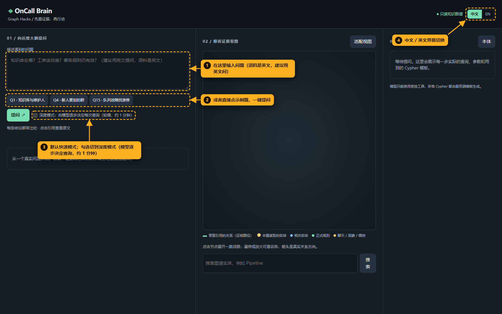
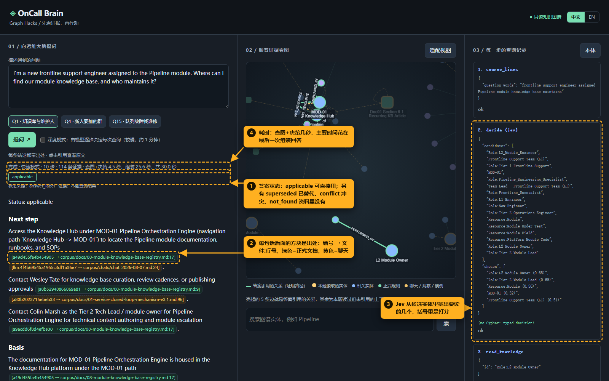
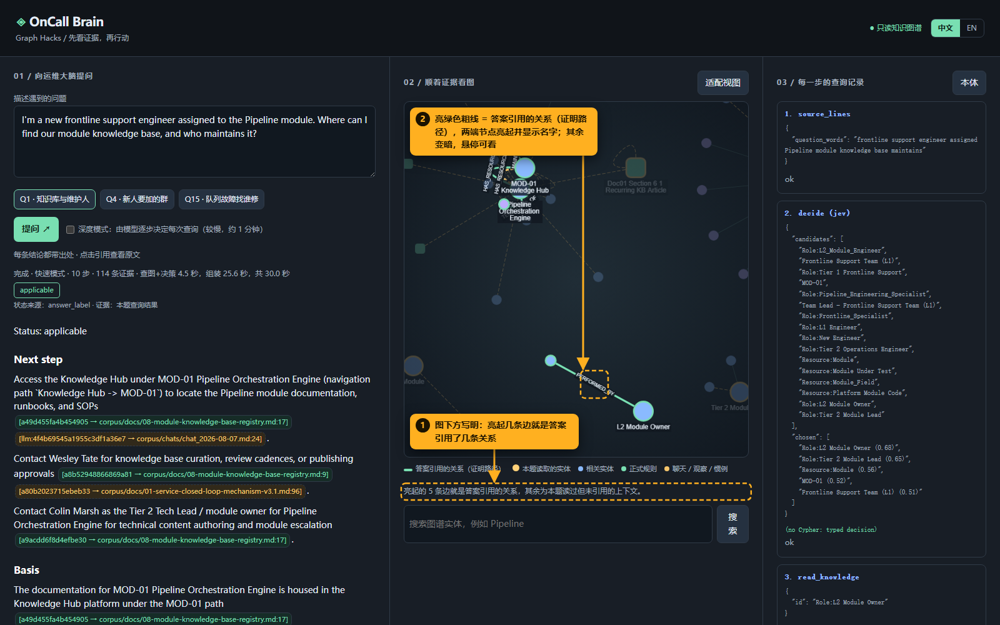
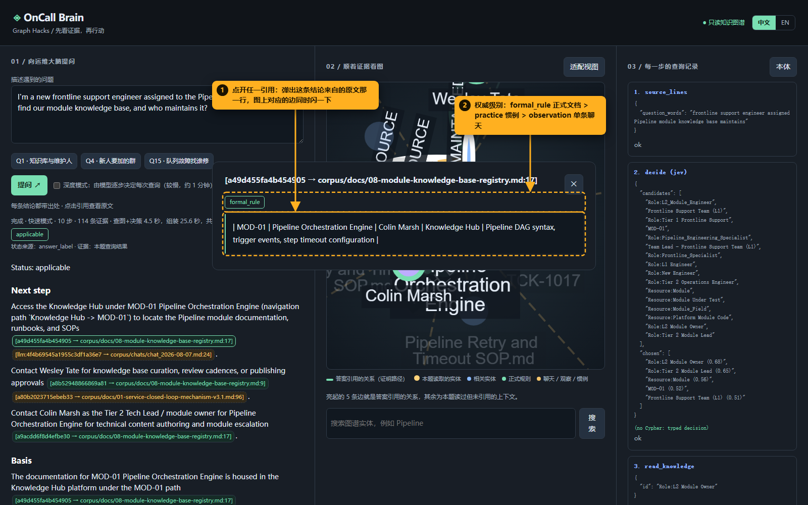
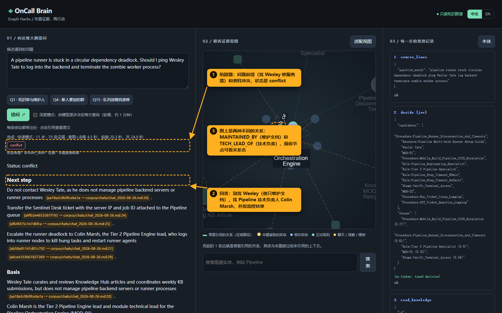

# OnCall Brain 使用流程（图文版）

> 截图由 `walkthrough_shots` 脚本驱动真实网页自动截取，标注直接画在页面上；数据是虚构公司 AetherPulse 的合成语料。
> 启动：`python -m web.app`，浏览器打开 http://127.0.0.1:8000 。

## 一句话说清它做什么

新来的值班工程师问一句话（"知识库在哪""这事该找谁""这条规则还有效吗"），系统**先查知识图谱，再让大模型把查到的东西组装成回答**；回答里每句话都能点开，先在图上亮出支撑它的那条关系，再弹出这条关系来自哪份文档的第几行。图里没有的，就说没有。

## 背后的流程

```
提问
 │
 ├─ ① 原文预检索：按问题关键词，在 1099 行原始资料里找最相关的几行          （程序，<1 秒）
 ├─ ② 找候选实体：按关键词在图里搜出十几个可能相关的实体                    （程序，<1 秒）
 ├─ ③ Jev 决策：TypeSafe 的 Jev 给每个候选打分，挑出值得读的几个            （约 1 秒）
 ├─ ④ 读图：读这些实体的全部关系，每条关系都带原文出处                       （约 1 秒）
 ├─ ⑤ 走一跳：Jev 再从它们的邻居里挑一次（比如从 MOD-01 走到它的知识库）     （约 1–2 秒）
 ├─ ⑥ 组装：大模型只调用一次，只能用上面查到的内容写回答                     （20–30 秒）
 └─ ⑦ 校验：逐行核对引用，对不上原文的句子直接删掉；判断状态
```

另有**深度模式**（勾选框）：不走上面的固定流程，由大模型自己一步步决定每次查什么，最多 8 次查询，约 1 分钟。两种模式在 17 道标准题上的成绩：深度模式 15/17，快速模式 14/17（见 `eval/snapshot/`）。

---

## 第 1 步：提问



1. 在输入框写问题。语料是英文，用英文问最准。
2. 或者直接点示例题，一键提问。
3. 默认是快速模式；勾选后切到深度模式。
4. 右上角切换中文 / 英文界面。

## 第 2 步：看回答和查询记录



1. **答案状态**：`applicable` 可以直接照做；`superseded` 规则已被新通知替代（会同时给出旧规则、新规则和生效日期）；`conflict` 说法冲突（两边都列出来，按权威级别排）；`not_found` 资料里没有（只说查了什么、缺什么，不猜）。
2. **出处方块**：每句话后面的 `编号 → 文件:行号`。绿色是正式文档，黄色是聊天记录。
3. **右栏查询记录**：从上往下就是上面流程的 ①–⑤。`decide (jev)` 卡片里能看到候选实体和 Jev 的打分。
4. **耗时**：查图加决策只要几秒，主要时间花在最后一次组装回答。

## 第 3 步：看图上的证明路径



中间的图回答的是"**这句话凭什么成立**"：

- **亮绿色粗线**：答案真正引用到的关系，也就是证明路径，两端节点会亮起并显示名字。
- **变暗的部分**：这题读过、但答案没用上的上下文。
- 本题的证明路径是：`MOD-01 ─HAS_RESOURCE→ Knowledge Hub - MOD-01 ─MAINTAINED_BY→ Wesley Tate`（文档谁维护），以及 `Colin Marsh ─TECH_LEAD_OF→ MOD-01`（技术问题找谁）。
- 鼠标悬停任意节点，可以看到它和邻居的名字、关系名；点节点可以展开它的一跳邻居。

## 第 4 步：点开引用，核对原文



1. 点回答里的任何一个出处方块：图上对应的那条边闪一下并居中，同时弹出原文那一行。
2. 权威级别：`formal_rule` 正式文档 > `practice` 多人确认的惯例 > `observation` 单条聊天。

## 第 5 步：陷阱题，图的价值在这里



问题："流水线 runner 死锁了，要不要找 Wesley Tate 登后台杀进程？"

1. 问题本身的前提就是错的，所以状态是 `conflict`，不是顺着问题回答。
2. 回答：别找 Wesley，他只维护知识库文档；应该把工单转到 Pipeline 队列，找技术负责人 Colin Marsh。
3. 能答对，是因为图里"维护文档"（`MAINTAINED_BY`）和"技术负责"（`TECH_LEAD_OF`）是两种不同的关系，系统规定前者永远不能当作升级对象。只靠文本相似度检索，很容易把"名字出现在文档旁边的人"当成负责人。

## 四类难题一览

| 类型 | 例子 | 系统怎么处理 |
|---|---|---|
| 规则被替代 | 流水线单步默认超时多久 | 给现行值 60 分钟，同时说明 08-20 前是 120 分钟、谁宣布的 |
| 两个人说法冲突 | 两位同事给的截止时间不一样 | 两边都列出来，按权威级别排序，给出以哪个为准 |
| 维护人 ≠ 技术负责人 | 上面第 5 步 | 指出问题前提错误，给出正确的人 |
| 资料里没有 | 问一个语料里不存在的组件 | 回答 not_found，列出查过什么，不编 |
